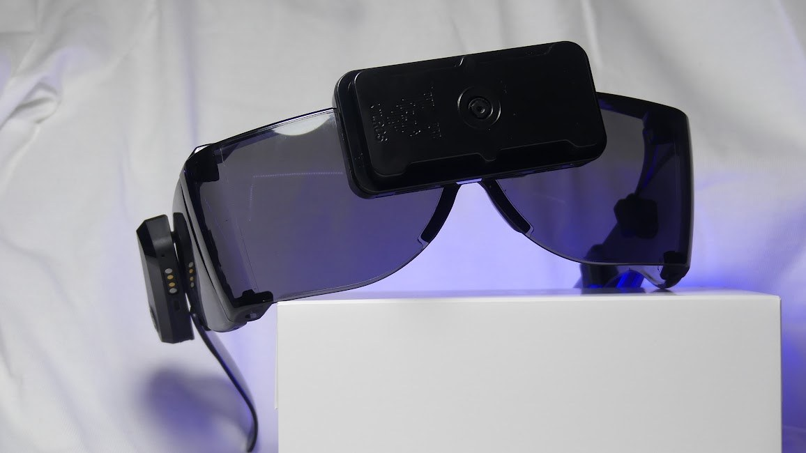

# Vision Through AI

A voice-activated smart-glasses prototype that photographs nearby objects, identifies them through Google Cloud Vision, and speaks the results. Built in 2023 and presented at the 2024 Connecticut Science & Engineering Fair.

## How it works

1. A wake-word listener triggers image capture on a Raspberry Pi Zero 2 W.
2. Python sends the captured image to Google Cloud Vision for object localization.
3. The program reads object names from the response and converts them to speech.

The project combined a Pi camera, a microphone, wearable audio, Python, Picovoice, Google Cloud Vision, and gTTS. I assembled the prototype, integrated the hardware and software, and measured how it responded to common objects.

## Recorded trials

| Object | Correct identifications |
| --- | ---: |
| Apple | 5 of 5 |
| Shoe | 5 of 5 |
| Guitar | 5 of 5 |
| Toothbrush | 0 of 5 |
| **Total** | **15 of 20** |

The research report recorded a mean response time of **5.903 seconds** across the four objects. The toothbrush results show how uneven recognition was across this small bench test.

## Explore

- [Camera and Raspberry Pi assembly](images/camera-and-pi.jpg)
- [Python response parsing example](examples/vision_response.py), written for this portfolio using fictional responses. Run it without hardware, network access, or credentials with `python3 examples/vision_response.py`.

**Recognition:** Infosys Foundation Computer Science Award Senior Finalist, PepsiCo Engineering Award Finalist, and Office of Naval Research Award.
